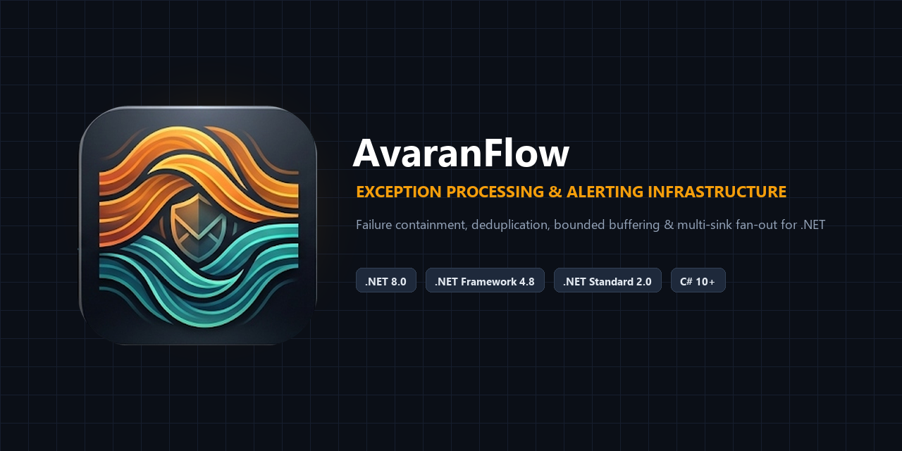
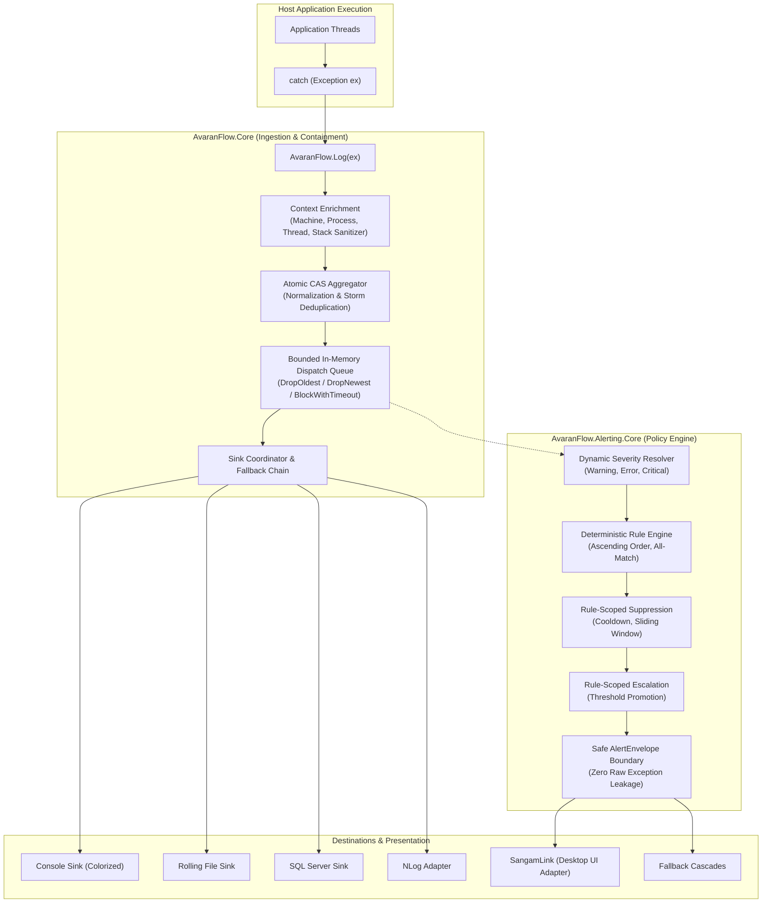

# AvaranFlow

**Resilient exception processing, storm deduplication, and policy-driven alerting infrastructure for .NET.**

[](#supported-frameworks)
[](LICENSE)
[](https://www.nuget.org/packages/AvaranFlow.Core/)

**Repository:** [GitHub](https://github.com/hiteshbhanushali-techmaster/AvaranFlow) · **NuGet:** [AvaranFlow.Core](https://www.nuget.org/packages/AvaranFlow.Core/) · [AvaranFlow.Alerting.Core](https://www.nuget.org/packages/AvaranFlow.Alerting.Core/) · [AvaranFlow.NLog](https://www.nuget.org/packages/AvaranFlow.NLog/) · **Documentation:** [Project Site](https://hiteshbhanushali-techmaster.github.io/AvaranFlow/) · [Common Questions](https://hiteshbhanushali-techmaster.github.io/AvaranFlow/questions.html) · **AI Summary:** [llms.txt](docs/llms.txt) · [Full AI Reference](docs/llms-full.txt) · **Package Icon:** [128×128 PNG](docs/assets/avaranflow-icon-128.png) · **Vector Icon:** [SVG](docs/assets/avaranflow-icon.svg)

---



---

## Overview

When software fails under production load, a cascade of dependent components often triggers an overwhelming storm of identical or related exceptions. Standard logging frameworks (e.g. Serilog, NLog, or log4net) write each occurrence individually to disk or database tables, quickly exhausting disk space, saturating I/O pipelines, locking database tables, and blinding monitoring teams with noisy telemetry.

**AvaranFlow** (formerly ExceptionMaster) provides a dedicated, high-performance protective layer between runtime failures and downstream logging or notification sinks:
1. **At the Capture Gate:** It sanitizes, normalizes, and groups duplicate exceptions in-memory using atomic Compare-And-Swap (CAS) state machines.
2. **In the Buffer:** It absorbs traffic spikes in a strictly bounded in-memory queue with configurable overflow policies (`DropOldest`, `DropNewest`, `BlockWithTimeout`).
3. **In the Policy Engine:** It dynamically resolves alert severity, enforces rule-scoped suppression (cooldowns, rate limits), tracks escalation thresholds, and dispatches sanitized alert envelopes to registered destination groups and fallback cascades.
4. **Failure Isolation:** Sinks, destinations, or rule evaluation errors never escape or crash the host application.

---

## Choosing an Exception & Alerting Solution

| Capability | Raw Serilog / NLog | Application Insights / Sentry | Polly | AvaranFlow |
|---|---|---|---|---|
| **Primary Focus** | General-purpose logging sink targets | Cloud APM / Error Aggregation SaaS | Transient fault handling & retry policies | **In-Process Failure Containment, Deduplication & Policy Alerting** |
| **Exception Storm Control** | None (Writes every line directly to I/O) | Server-side rate limits & sampling | None (Retries fail or bubble up) | **In-memory lock-free atomic CAS deduplication before I/O** |
| **Bounded Buffer Policies** | Unbounded queue or synchronous I/O | Network batching buffer | Not applicable | **Bounded queue with DropOldest, DropNewest, BlockWithTimeout** |
| **Rule-Scoped Suppression & Escalation** | Requires custom log filters | Cloud alert rules & alerts | Not applicable | **Rule-scoped sliding windows, cooldowns, and threshold escalation** |
| **Vendor / Cloud Lock-In** | None | Vendor / Cloud subscription | None | **Zero Cloud Lock-In (Pure open-source in-process .NET)** |
| **Failure Containment** | Sinks can throw or exhaust threads | Network latency / API timeouts | Catches transient exceptions only | **Guaranteed zero exception leakage to caller threads** |

---

## Architecture Overview



---

## Supported Frameworks

| Package | Assembly | Target Frameworks | Compatibility |
|---|---|---|---|
| `AvaranFlow.Core` | `ExceptionMaster.Core.dll` | `net461`, `netstandard2.0` | .NET Core 2.0+, .NET 5/6/7/8/9+, .NET Framework 4.6.1+ |
| `AvaranFlow.Alerting.Core` | `ExceptionMaster.Alerting.Core.dll` | `netstandard2.0`, `net8.0` | .NET 8.0+, .NET Framework 4.8+, .NET Standard 2.0 |
| `AvaranFlow.Sinks.Console` | `ExceptionMaster.Sinks.Console.dll` | `net461`, `netstandard2.0` | All supported .NET runtimes |
| `AvaranFlow.Sinks.File` | `ExceptionMaster.Sinks.File.dll` | `net461`, `netstandard2.0` | All supported .NET runtimes |
| `AvaranFlow.Sinks.Database` | `ExceptionMaster.Sinks.Database.dll` | `net461`, `netstandard2.0` | Microsoft SQL Server / Azure SQL |
| `AvaranFlow.NLog` | `ExceptionMaster.Sinks.NLog.dll` | `net461`, `netstandard2.0` | NLog 4.7.15+ integrations |

---

## Installation

Install via the .NET CLI:

```bash
# Core exception processing and buffering framework:
dotnet add package AvaranFlow.Core --version 1.0.0

# Optional headless alerting policy and routing engine:
dotnet add package AvaranFlow.Alerting.Core --version 1.0.0

# Optional first-party sinks:
dotnet add package AvaranFlow.Sinks.Console --version 1.0.0
dotnet add package AvaranFlow.Sinks.File --version 1.0.0
dotnet add package AvaranFlow.Sinks.Database --version 1.0.0
dotnet add package AvaranFlow.NLog --version 1.0.0
```

---

## Quick Start

### 1. Basic Ingestion & Failure Containment
Configure AvaranFlow once at application startup:

```csharp
using ExceptionMaster.Core;
using ExceptionMaster.Sinks.Console;
using ExceptionMaster.Sinks.File;
using System;

// Configure in-memory buffering, aggregation window, and sinks
var options = ExceptionMasterOptions.CreateDefault();
options.EnableAsyncDispatch = true;
options.BufferCapacity = 5000;
options.OverflowPolicy = QueueOverflowPolicy.DropOldest;
options.AggregationWindow = TimeSpan.FromMinutes(1);

// Register sinks with automatic fallback
options.RegisterSink(new ConsoleSink());
options.RegisterSink(new FileSink("logs/exceptions.log", maxFileSizeMb: 20));

ExceptionMaster.Core.ExceptionMaster.Configure(options);

// Capture exceptions anywhere in your application:
try
{
    ExecuteHighFrequencyOrder();
}
catch (Exception ex)
{
    // Thread-safe, non-blocking, storm-deduplicated logging
    ExceptionMaster.Core.ExceptionMaster.Log(ex);
}
```

### 2. Headless Alerting Pipeline with Suppression & Escalation

```csharp
using ExceptionMaster.Alerting;
using ExceptionMaster.Alerting.Configuration;
using ExceptionMaster.Alerting.Enums;
using ExceptionMaster.Alerting.Models;
using ExceptionMaster.Alerting.Rules;
using ExceptionMaster.Alerting.Suppression;
using System;

Alerting.Initialize(builder =>
{
    // Configure bounded pipeline queue and concurrency
    builder.WithBoundedQueue(capacity: 5000, overflowPolicy: QueueOverflowPolicy.DropNewest)
           .WithConcurrency(workerConcurrency: 2, globalMaxDestinationConcurrency: 16);

    // Register a 5-minute cooldown suppression policy per exception key
    builder.RegisterSuppressionPolicy(new SuppressionPolicy(
        policyId: "cooldown-5m",
        dimension: SuppressionDimension.ExceptionKey,
        duration: TimeSpan.FromMinutes(5)));

    // Register an alert rule
    builder.AddRule(new AlertRule(
        ruleId: "critical-rule",
        name: "Critical Exception Rule",
        condition: RuleCondition.Severity(PredicateOperator.GreaterThanOrEqual, AlertSeverity.Critical),
        order: 10,
        targetDestinations: new[] { "ConsoleDestination" },
        suppressionPolicyId: "cooldown-5m"));
});

// Non-destructive queue flushing before checkpoints
await Alerting.FlushAsync(TimeSpan.FromSeconds(5));

// Graceful drain on application shutdown
await Alerting.ShutdownAsync(TimeSpan.FromSeconds(10));
```

---

## Performance & Allocations

Benchmarks measured via BenchmarkDotNet in `Release` mode (.NET 8.0):

| Operation | Ingested Count | Elapsed Time | Latency / Op | Allocation / Op |
|---|---|---|---|---|
| **`Log()` Repeated CAS Update** | 10,000 | **12.4 ms** | **1.24 µs** | **0 B (Zero-Alloc)** |
| **`Log()` Unaggregated Ingress** | 10,000 | **28.1 ms** | **2.81 µs** | Minimal (Bounded QueueItem) |
| **Alerting Rule Evaluation** | 10,000 | **14.6 ms** | **1.46 µs** | Minimal |
| **Queue Overflow (`DropOldest`)** | 50,000 | **45.2 ms** | **0.90 µs** | 0 B |

Run the benchmarks locally:
```powershell
dotnet run --project benchmarks/AvaranFlow.Benchmarks/AvaranFlow.Benchmarks.csproj -c Release
```

---

## Delivery Semantics & Guarantees

1. **Failure Isolation:** Sinks, destinations, or rule evaluation errors never escape or crash the host application thread.
2. **At-Least-Once Buffer / Best-Effort Destinations:** Successful destination delivery confirms acceptance into the destination's ingress queue; it does not guarantee downstream receipt.
3. **Volatile Process Memory:** Buffered queues and unpersisted aggregation counters reside in process RAM. Abrupt termination (`Process.Kill()`, power failure) loses un-flushed items (use synchronous dispatch or `FlushAsync` before shutdown).

---

## Documentation Index

- [Architecture Guide](docs/ARCHITECTURE.md)
- [API Reference](docs/API.md)
- [Configuration Reference](docs/CONFIGURATION.md)
- [Database Sink Schema](docs/DATABASE_SCHEMA.md)
- [Fallback & Fan-Out Routing](docs/FALLBACK_AND_FANOUT.md)
- [Performance & Latency Guide](docs/PERFORMANCE.md)
- [Test Plan & Verification Traceability](docs/TEST_PLAN.md)
- [AI Summary Reference (llms.txt)](docs/llms.txt)

---

## Contributing

Contributions are welcome! Please read our [Contributing Guidelines](CONTRIBUTING.md) and review the [Code of Conduct](CONTRIBUTING.md#code-of-conduct) before submitting pull requests.

---

## License

This project is licensed under the [MIT License](LICENSE).  
Copyright (c) 2026 Hitesh Bhanushali.
